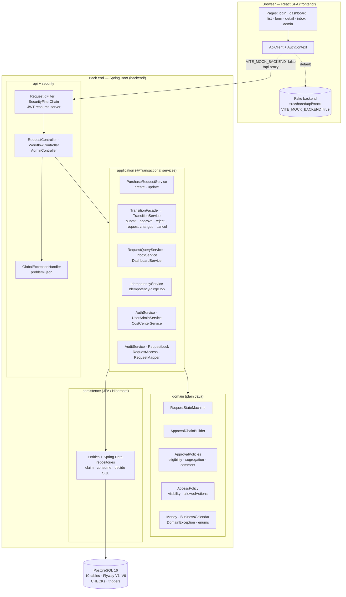

# Architecture Overview

> Purchase-request module with cost-center budgets, sequential multi-step approval, segregation of duties,
> versioning, concurrency control and idempotency (Kingspan `teste-pleno`, README §1–5).
> Style: **modular monolith** with a **pure domain package** (ADR-001, ADR-003).
> Stack: **Java 25 + Spring Boot 4.1 + Spring Data JPA/Hibernate + Flyway + PostgreSQL 16**; **React 18 + Vite + Ant Design** (ADR-002, ADR-013).
> State: front end runs (fake backend by default); back end drafted, not yet compiled — see `docs/README.md`.

## 1. Architecture in One Paragraph

Two deployables: a **Spring Boot back end** (`backend/`) exposing the REST API of `api/openapi.yaml`, and a
**React single-page application** (`frontend/`). Inside the back end, `domain` is plain Java (state
machine, chain builder, approval/access policies, `Money`, business calendar, sealed `DomainException`)
with no Spring, JPA or HTTP imports, so the rules are unit-testable without a server or database
(README §5.1). `application` holds one `@Transactional` service method per use case; `persistence` holds
JPA entities and Spring Data repositories, including the few explicit SQL statements that carry the
concurrency guarantees: the optimistic `lock_version` claim as the first write, the conditional budget
update, and status-guarded step decisions (ADR-009). `api` and `security` adapt HTTP and JWT. The SPA
renders only what the API allows (`allowedActions`) and can run against an in-browser fake backend.

## 2. Component Map

## 3. Package Boundaries

| Package | Responsibility | Depends on |
|---|---|---|
| `domain` | business rules as pure functions and values | nothing |
| `persistence` | entities, repositories, concurrency SQL | `domain` |
| `application` | use cases, transactions, queries, idempotency, audit, DTO mapping | `domain`, `persistence`, `api.dto` |
| `security` | JWT encode/decode, filter chain, `CurrentUser` (user re-loaded from DB per request) | `persistence`, `config` |
| `api` | controllers, DTO records, `GlobalExceptionHandler`, `RequestIdFilter` | `application`, `security` |
| `config` | typed `app.*` properties, `Clock`/`BusinessCalendar` beans, `DemoSeed` | all |

Rule: entities never leave the back end — controllers return DTO records built by `RequestMapper` / `UserMapping`.

## 4. Key Architectural Decisions (full text in `docs/adr/`)

| Decision | Choice | ADR |
|---|---|---|
| Architecture style | Modular monolith, pure domain package | ADR-001 |
| Stack | Java 25 · Spring Boot 4.1 · JPA/Hibernate · Flyway · PostgreSQL 16; React · Vite · Ant Design | ADR-002 |
| Domain boundaries | Aggregate `PurchaseRequest` (working copy + versions + steps); `Budget`, `User`, `CostCenter` | ADR-003 |
| Data model | Constraints and triggers as business rules | ADR-004 |
| Money | Integer cents, decimal-string serialization | ADR-005 |
| AuthN | Stateless HS256 JWT (15 min), BCrypt, user re-loaded per request | ADR-006 |
| AuthZ | Filter chain authenticates; services check visibility → role/owner → rules in §4.3 order | ADR-007 |
| Transactions | One `@Transactional` method per use case; failed-budget audit in `REQUIRES_NEW` after rollback | ADR-008 |
| Concurrency | `lock_version` claim as first write + conditional budget UPDATE + status-guarded steps | ADR-009 |
| Idempotency | `idempotency_keys` reserved with `INSERT … ON CONFLICT` in the create transaction | ADR-010 |
| Versioning/history | Working copy + immutable snapshots + append-only events | ADR-011 |
| 403 vs 404 | 404 for invisible resources (drafts: owner only, ADMIN included); 403 for role/ownership | ADR-012 |
| Front end | Vite SPA, Ant Design, TanStack Query, URL state, `allowedActions`, swappable fake backend | ADR-013 |
| Testing | JUnit (domain), Testcontainers (integration + concurrency), Cypress (E2E) | ADR-014 |

## 5. Quality Attributes

| Attribute | Mechanism |
|---|---|
| Correctness under concurrency | Lock claim first (409) → conditional budget UPDATE (422, never negative) → status-guarded step update |
| Testability | Domain has no I/O; injected `Clock`; policies are static pure functions |
| Auditability | Append-only `request_events` (actor, role, statuses, step, version, comment, UTC time, `X-Request-Id`); DB triggers block UPDATE/DELETE |
| Extensibility | Chain thresholds and eligibility are small table-like functions; new rules touch one class |
| Observability | ECS JSON logs with `requestId` in the MDC; `/health` includes the database |
| Deployability | Flyway + seed run on start-up; `docker compose` **not written yet** |
