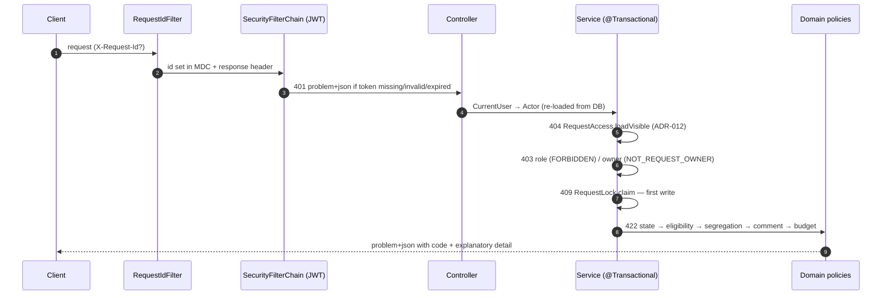

# System Design

> Companion to `OVERVIEW.md`: the runtime design as implemented. Diagram sources: `diagrams/` (Mermaid)
> and `uml/` (PlantUML). Back end: `backend/` (Spring Boot); front end: `frontend/` (React SPA).

## 1. Request Lifecycle (end-to-end)

1. **Create** — `POST /requests` (`IdempotencyService` → `PurchaseRequestService.create`): DRAFT with the
   working copy (title, description, category, cost center, neededBy, items); total computed server-side
   in cents; owner = caller. Event `REQUEST_CREATED`.
2. **Edit** — `PUT /requests/{id}`: owner only, `DRAFT`/`CHANGES_REQUESTED` only, `lockVersion` claimed
   first; items replaced wholesale. Event `EDITED`.
3. **Submit** — `POST /requests/{id}/submit` (`TransitionService.submit`): freezes `request_versions`
   (n = current + 1, with frozen cost center and `competence_month` in America/Sao_Paulo) +
   `version_items`, builds `approval_steps` with `ApprovalChainBuilder`, status `PENDING_APPROVAL`.
   Event `SUBMITTED` or `RESUBMITTED`.
4. **Approve** — `TransitionFacade.approve` → `TransitionService.decide`: 404 visibility → 403 role →
   **lock claim (first write; 0 rows → 409)** → 422 state → eligibility → segregation → comment → if last
   step, conditional budget UPDATE (insufficient → whole transaction rolls back → facade writes
   `APPROVAL_FAILED_BUDGET` in a new transaction → `422 BUDGET_EXCEEDED`) → step `APPROVED` (status-guarded)
   → status `APPROVED` or still pending. Event `APPROVED`.
5. **Reject / Request changes** — same pipeline + comment ≥ 10 chars (`COMMENT_REQUIRED`); the current
   step becomes `REJECTED`/`RETURNED`, later steps `SKIPPED`. Events `REJECTED` / `CHANGES_REQUESTED`.
6. **Cancel** — owner or ADMIN (else `403 NOT_REQUEST_OWNER`); from `PENDING_APPROVAL` the current step
   becomes `CANCELLED`, later ones `SKIPPED`. Event `CANCELLED`.

Each step is one database transaction (ADR-008). Reads never lock.

## 2. Verification Order (README §4.3)

Bean validation of the request body (e.g. missing `lockVersion`, malformed price) answers **400 before**
the 404/403 stages — a documented deviation from a strict reading of §4.3.

## 3. Concurrency and Idempotency

| Hazard | Mechanism | Client sees |
|---|---|---|
| Lost update on any transition/edit | `UPDATE purchase_requests SET lock_version = lock_version + 1 WHERE id = ? AND lock_version = ?` as the first write | `409 CONCURRENCY_CONFLICT` + `currentLockVersion` |
| Same step approved twice concurrently | The claim above (the loser waits on the row lock, re-evaluates, gets 0 rows) + `UPDATE approval_steps … WHERE status = 'PENDING'` | one 200, one 409 — even on a final step with almost no budget |
| Concurrent finals overdrawing a budget | `UPDATE budgets SET consumed_cents = consumed_cents + ? WHERE … AND consumed_cents + ? <= amount_cents` + `CHECK` | 0 rows → `422 BUDGET_EXCEEDED`; balance never negative |
| Admin lowers a budget while it is consumed | `SELECT … FOR UPDATE` before the "≥ consumed" check | `422 BUDGET_BELOW_CONSUMED` |
| Duplicate create on retry | `idempotency_keys` reserved with `INSERT … ON CONFLICT … RETURNING` in the create transaction | same payload → stored response replayed; different → `409 IDEMPOTENCY_PAYLOAD_MISMATCH` |

## 4. Error Handling

- Every error is RFC 9457 `application/problem+json`: `type`, `title`, `status`, `detail`, `code`,
  `requestId`, plus `errors[]` (400) or `currentLockVersion` (409).
- Business failures are a sealed `DomainException` hierarchy (`Invalid`, `NotFound`, `Forbidden`,
  `Conflict`, `RuleViolation`, `BudgetExceeded`); `GlobalExceptionHandler` maps them with an exhaustive
  `switch`. Bean-validation, malformed JSON, type mismatches, auth exceptions, unknown routes and
  constraint violations are mapped too; anything else → `500 INTERNAL` with the correlation id, stack trace only in logs.
- 401/403 raised by the security filters use the same shape (`ProblemResponses`).

## 5. Transactions

| Operation | Boundary | Locking |
|---|---|---|
| create | `PurchaseRequestService.create` (inside the idempotency `TransactionTemplate` when a key is sent) | key reservation |
| edit | `PurchaseRequestService.update` | lock claim first |
| submit / resubmit | `TransitionService.submit` | lock claim first; inserts version, items, steps |
| approve / reject / request-changes | `TransitionService.decide` via `TransitionFacade` | lock claim → [budget UPDATE] → step UPDATE; budget failure = full rollback, audit in `REQUIRES_NEW` |
| cancel | `TransitionService.cancel` | lock claim first |
| set budget | `CostCenterService.setBudget` | `PESSIMISTIC_WRITE` row lock |

Isolation: READ COMMITTED. Detail: `database/TRANSACTION-STRATEGY.md`.

## 6. Front End

- **Shell**: Ant Design `Layout` + `Sider`; routes guarded by `RequireAuth`/`RequireRole` (403 `Result`
  page for the wrong role — UX only, the API still enforces).
- **Data**: TanStack Query; `ApiClient` sends `Authorization` + `X-Request-Id`, turns `problem+json` into `ApiError`.
- **Lists**: filters, sort and page in the URL (`useSearchParams`); server-side paging/sorting through the antd `Table`.
- **Detail**: buttons only from `allowedActions`; comment modal (≥ 10 chars) for reject/return; `409` →
  warning banner + refetch; `422` → the server's `detail` inside the modal.
- **Session**: token in `sessionStorage`; any `401` → `/login?returnUrl=…`, back to the route after login.
- **Fake backend** (default): the API contract implemented in the browser, persisted in `localStorage`.

## 7. Deployment (current state)

- **Back end**: `backend/Dockerfile` (Temurin 25 JDK build → JRE runtime, non-root, port 3000). Flyway
  migrations and the demo seed run on start-up; the seed runs once (skipped when its users exist).
- **Front end**: `npm run dev` (Vite, port 5173, `/api` proxy → `http://localhost:3000`); no container yet.
- **Not written yet**: root `docker-compose.yml` (db + backend + frontend) and the CI workflow — both
  required by README §5.3. Planned shape: `diagrams/deployment.md`.

## 8. Repository Compliance

Work happens only in allowed paths (`backend/`, `frontend/`, `docs/`, root `.env.example`); no tool
changes `core.hooksPath`; AI-assisted changes are logged by the repository hooks (AGENTS.md).
