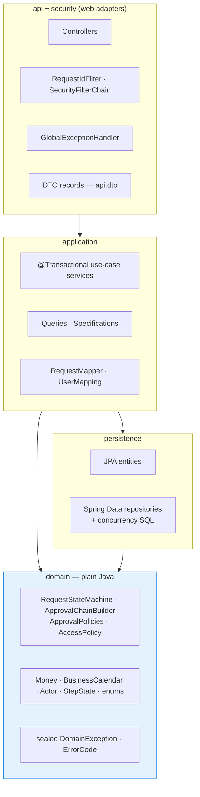

# Diagram — Back-end Packages and Dependency Direction

Rules (by package convention and review; an ArchUnit test would make them executable):

1. `domain` imports nothing from the other packages and no Spring, JPA or servlet types (README §5.1).
2. The domain receives plain values (`Actor`, `StepState`, `AccessPolicy.RequestView`), never entities.
3. `application` owns transactions; controllers never touch repositories.
4. Entities never reach HTTP: controllers return DTO records built by the mappers.
