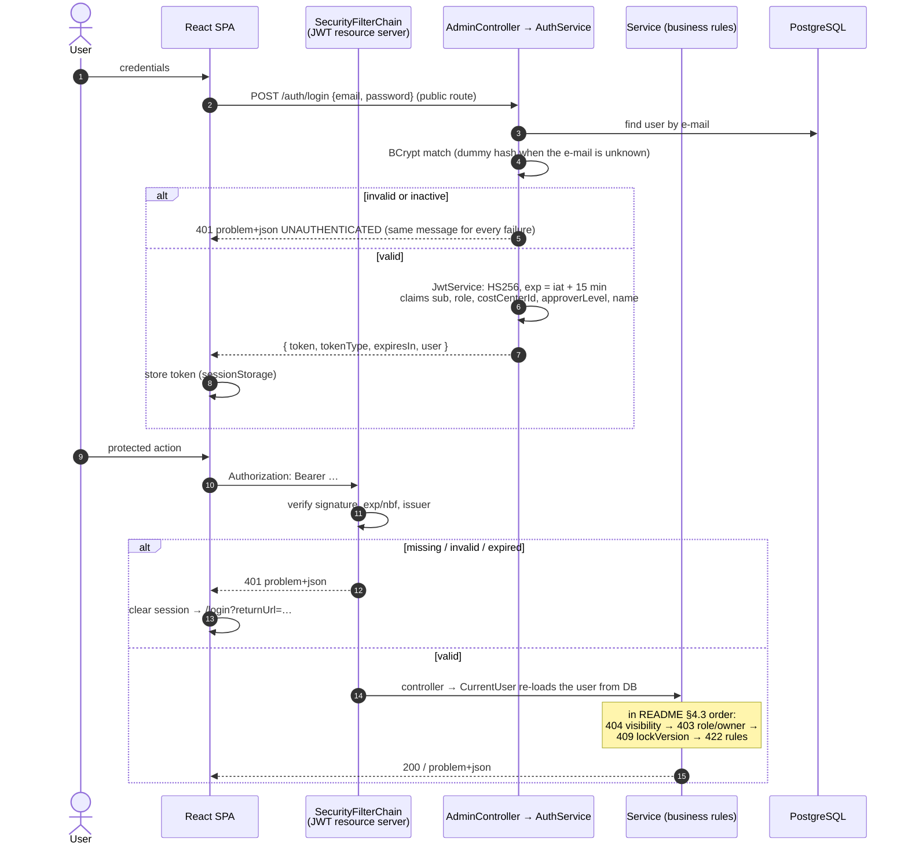

# Diagram — Authentication and Authorization Flow

Design points (ADR-006, ADR-007):
- The filter chain only authenticates. Role, ownership, eligibility and segregation run in the services
  with pure domain policies — a URL-level role rule would answer 403 before the 404 visibility check.
- Token claims are informational; the user is re-loaded per request, so role changes and deactivation
  apply immediately.
