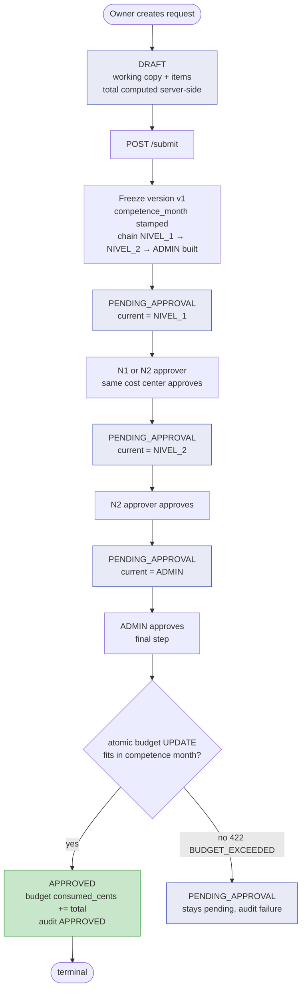

# Diagram — Main Business Process (happy path > R$10.000, non-SOFTWARE)

Variant paths (documented in the state machine and sequence diagrams):
- **SOFTWARE** category → `ADMIN` appended as final step even below R$10.000.
- **≤ R$1.000** → single `NIVEL_1` step; **R$1.000,01–10.000** → two steps.
- **reject** at any current step → `REJECTED` (comment mandatory).
- **request-changes** → `CHANGES_REQUESTED` → owner edits → resubmit freezes **v2** with recalculated chain.
- **cancel** from any non-final state → `CANCELLED`.
