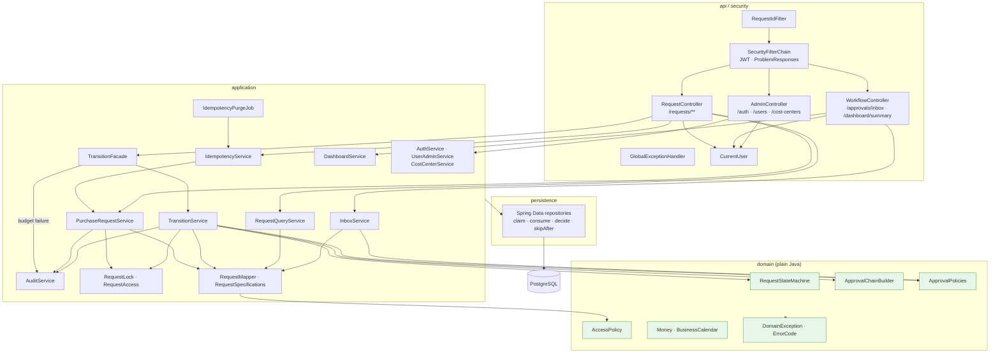

# Diagram — Back-end Components (C4 Level 3)

Reading guide: arrows are allowed calls. Domain classes never import Spring/JPA. Controllers never call
repositories. `GlobalExceptionHandler` turns every exception leaving a controller into `problem+json`.
