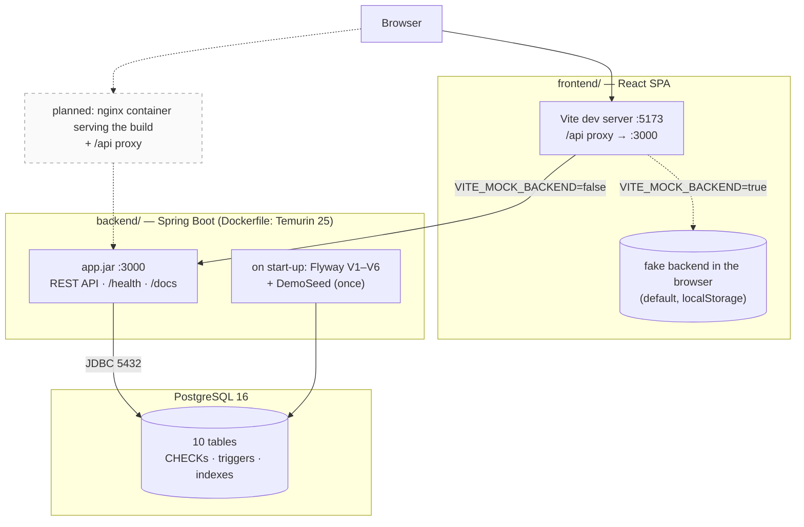

# Diagram — Containers (C4 Level 2)

Current state: the back end has a `Dockerfile`; the front end runs with Vite; **there is no
`docker-compose.yml` yet** (README §5.3 requires one). The dashed parts are the planned compose layout.

Container responsibilities:
- **frontend**: SPA; in development the Vite proxy forwards `/api/*` to the back end (prefix stripped).
- **backend**: stateless API; applies pending migrations and the one-time seed before serving.
- **db**: the only persistent store.
