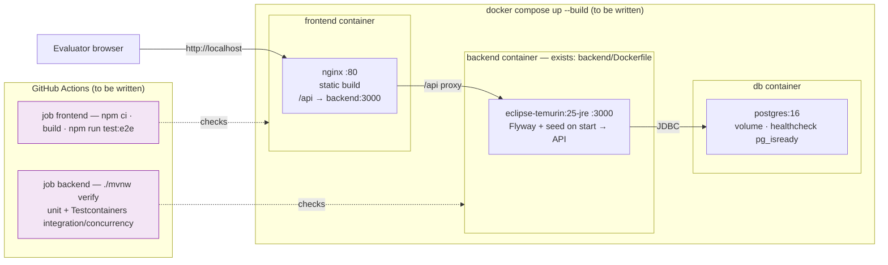

# Diagram — Deployment Architecture (planned; not implemented yet)

> **Status:** neither the root `docker-compose.yml` nor the CI workflow exists yet. This is the target
> shape for README §5.3; what exists today is `backend/Dockerfile` and the front end's Vite setup.

Facts that already hold:
- The back end needs no manual step: Flyway migrates and `DemoSeed` seeds on start-up (README §5.3).
- Environment variables are listed in the root `.env.example` (`DB_*`, `JWT_*`, `PORT`, `SEED_ENABLED`, `VITE_MOCK_BACKEND`).
- For compose, the front end must be built with `VITE_MOCK_BACKEND=false`, otherwise it keeps using the in-browser fake backend.
