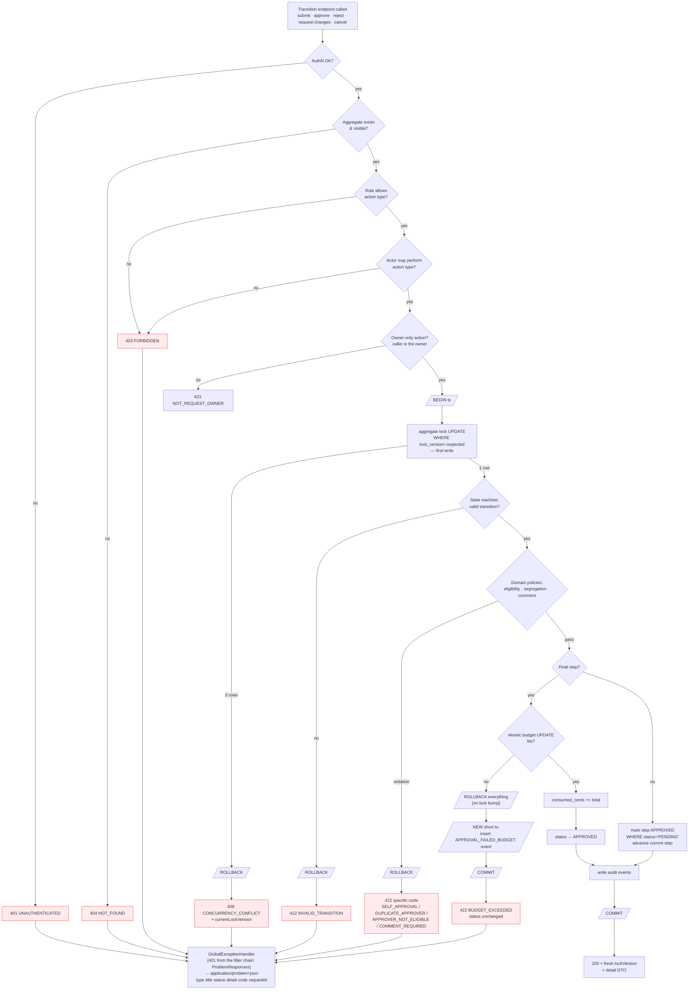

# Diagram — Error Handling and Transaction Flow (transition actions)

Key facts:
- The lock guard is the aggregate's conditional `lock_version` UPDATE — the **first write** inside the transaction. A racing second approver's UPDATE waits on the row lock and re-evaluates on the winner's commit → 0 rows → **409** (README §2.3.5: one succeeds, the other gets 409 — never a business 422).
- Owner-only actions (edit/submit by non-owner, cancel by non-owner non-ADMIN) fail with `403 NOT_REQUEST_OWNER` before the transaction opens.
- On `BUDGET_EXCEEDED` the transition transaction rolls back **everything** (including the lock bump); only the `APPROVAL_FAILED_BUDGET` audit event is written, in a separate short transaction.
- `409` precedes all business-rule checks (BR-014); every rejection path produces an explanatory `detail` message (BR-015).
