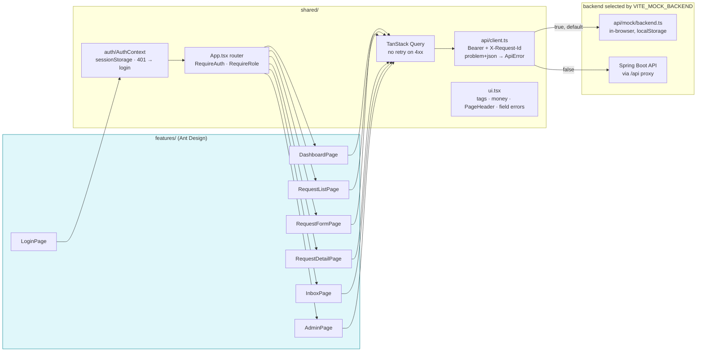

# Diagram — Front-end Request Flow

Rules the front end obeys (README §2.7), each covered by a Cypress spec:
1. List state (filters, sort, page) lives in the URL — links are shareable (`03-request-list`).
2. Action buttons come only from `allowedActions` (`05-request-detail`).
3. The form total is display only; the server recalculates (`04-request-form`).
4. `401` anywhere → login → back to the original route (`01-login`).
5. `409` → "Alguém agiu antes de você" banner + refetch; `422` → the server's `detail` (`05-request-detail`).
