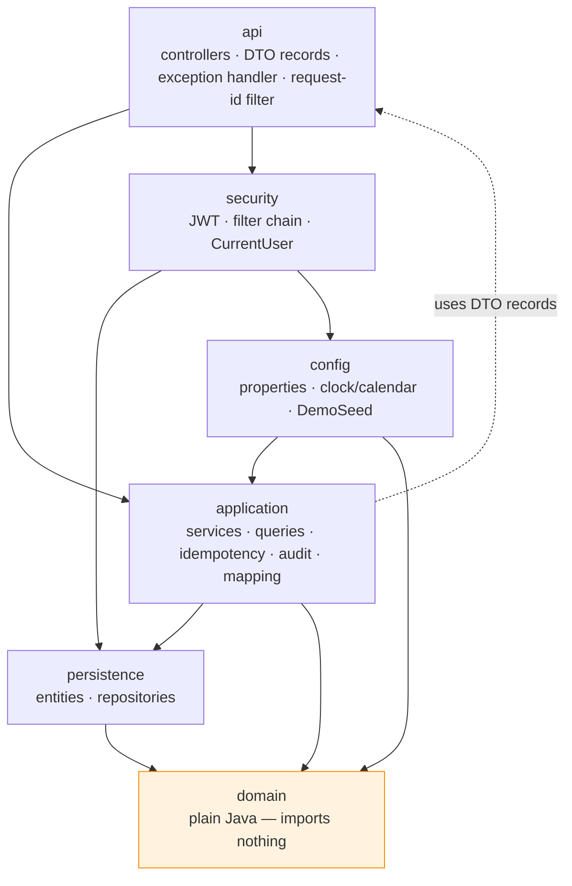

# Diagram — Back-end Package Dependencies

Notes:
- `domain` is the only package with no outgoing dependency — the requirement of README §5.1.
- `application` reuses the DTO records of `api.dto` as its output types (a pragmatic shortcut: no
  separate application-level result types). It does not depend on controllers.
- `config.DemoSeed` drives the real services, so the seed exercises the same rules as the API.
