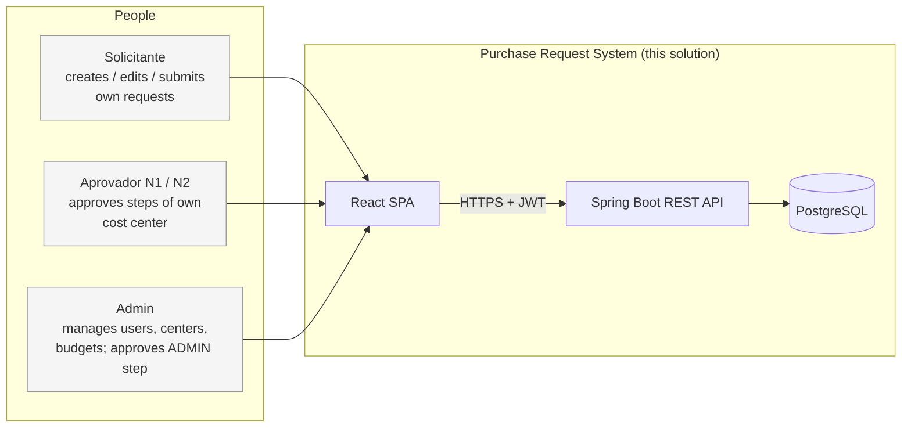

# Diagram — System Context (C4 Level 1)

Notes:
- Actors map to README §1.1 (`SOLICITANTE`, `APROVADOR` with `approverLevel`, `ADMIN`).
- The SPA talks **only** to the REST API; business rules exist solely server-side (README §1, §2.7).
- No external systems are required by the challenge; SMTP/metrics are optional differentiators (§6).
