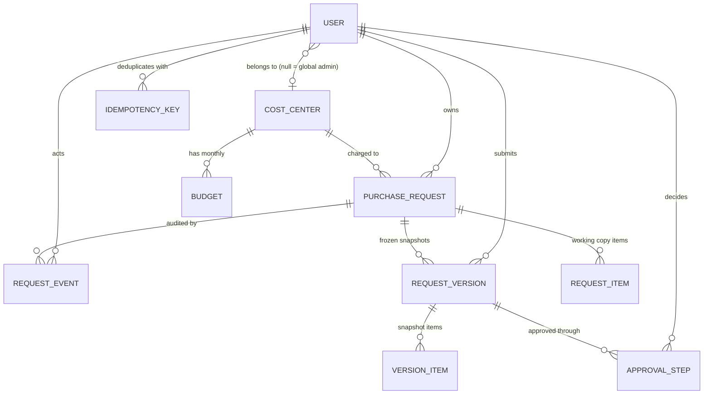

# Conceptual ERD

> Domain-level view: entities, cardinalities and business meaning. No column-level detail here
> (see ERD-LOGICAL.md / ERD-PHYSICAL.md). Mermaid `erDiagram` source below.

## Entity business dictionary (conceptual)

| Entity | Business meaning | Key invariants |
|---|---|---|
| `USER` | Account with role (`SOLICITANTE`, `APROVADOR`, `ADMIN`), optional `approverLevel`, optional cost center (null ⇒ global admin) | `APROVADOR` ⇒ `approverLevel` present; other roles ⇒ absent. Email unique |
| `COST_CENTER` | Organizational unit that carries monthly budgets | `code` unique |
| `BUDGET` | Monthly allocation (amount, consumed) for one cost center | `consumed ≤ amount`; unique per (center, month); month without row = zero balance |
| `PURCHASE_REQUEST` | The aggregate: working copy + status + current version pointer + optimistic lock | Status changes only via valid transitions; `lockVersion` ≠ business version |
| `REQUEST_ITEM` | Editable line of the working copy (`quantity × unitPrice`) | qty > 0, price > 0; replaced wholesale on edit |
| `REQUEST_VERSION` | Immutable snapshot frozen at each submit, with competence month | Never updated; unique (request, n) |
| `VERSION_ITEM` | Frozen line of a snapshot | qty > 0, price > 0 |
| `APPROVAL_STEP` | One ordered step of a version's chain | One `APPROVED` step per (version, sequence); approved in order |
| `REQUEST_EVENT` | Append-only audit record of every action | Never updated/deleted (DB-enforced) |
| `IDEMPOTENCY_KEY` | Deduplication record for `POST /requests` | Unique (user, key); payload hash gates replay vs 409 |

## Why this shape (ADR-004, ADR-011)

- **Working copy + frozen versions** instead of versioned mutable rows: resubmission ("v2, v3…")
  becomes a pure INSERT, guaranteeing immutability of the past — the exact property the audit requirement demands.
- **`competence_month` lives on the version**, not derived at consumption time: replays and audits are
  deterministic and a resubmission in another month naturally re-targets the budget (BR-007).
- **Events reference statuses/steps redundantly** (not only FKs) so history stays meaningful even if
  reference data evolves — history must explain *what was seen at the time*.
