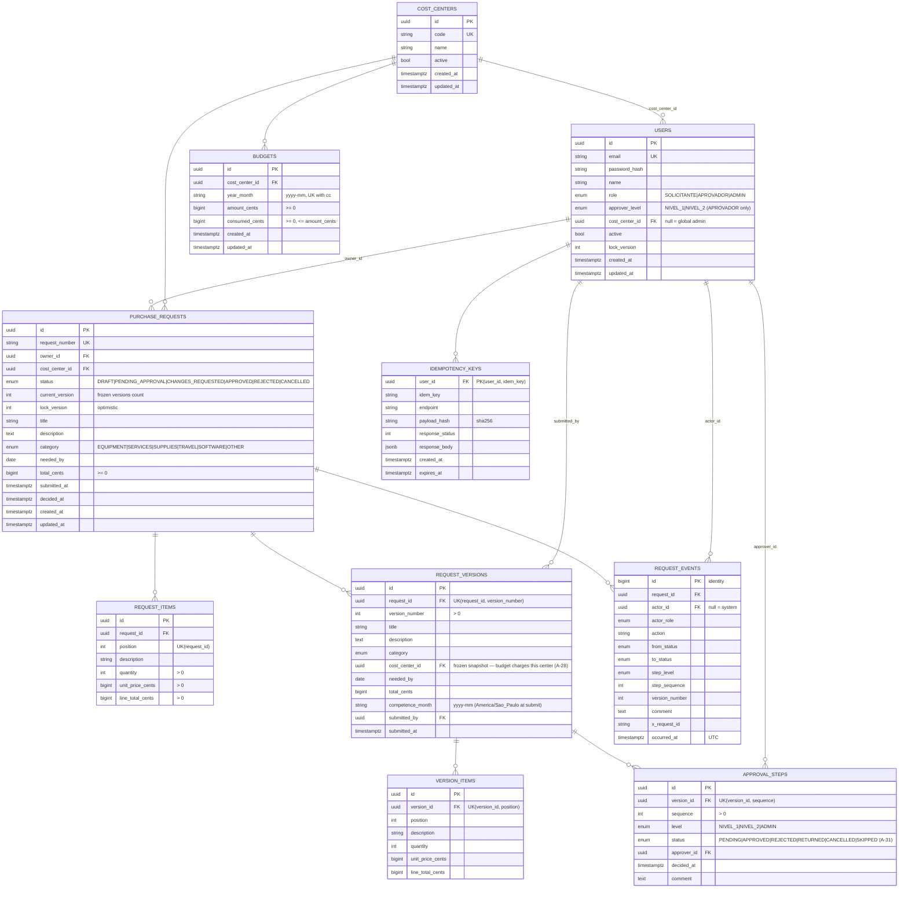

# Logical ERD

> Attribute-level model (types shown PostgreSQL-logical; sizes/constraints fully specified in
> ERD-PHYSICAL.md). Mermaid erDiagram with keys and cardinalities.

## Relationship rules (logical)

| # | Rule |
|---|---|
| R1 | A `USERS.cost_center_id` is NULL **only** for global `ADMIN`s (asserted by application; column stays nullable) |
| R2 | `BUDGETS` unique (cost_center_id, year_month); deleting a cost center is forbidden while budgets/requests reference it (RESTRICT) |
| R3 | `PURCHASE_REQUESTS.current_version` = max `REQUEST_VERSIONS.version_number`; 0 when never submitted |
| R4 | `REQUEST_ITEMS` are replaced wholesale (DELETE+INSERT in tx) on every working-copy edit |
| R5 | `APPROVAL_STEPS` ordered by (version_id, sequence); current step = first PENDING; statuses ∈ PENDING/APPROVED/REJECTED/RETURNED/CANCELLED/SKIPPED — reject marks the current step REJECTED, request-changes RETURNED, cancel CANCELLED; later steps become SKIPPED in the same tx (A-31) |
| R6 | `REQUEST_EVENTS` have **no** update/delete path; FKs are the only mutable-reference risk and they point to immutable identities |
| R7 | `IDEMPOTENCY_KEYS` rows are insert-only; lazy purge deletes only expired rows |

## Normalization assessment

- All tables are in 3NF: no transitive dependencies (statuses/enums as checks, not lookup tables — they are closed sets fixed by the challenge).
- Denormalization, deliberate and documented:
  - `PURCHASE_REQUESTS.total_cents` duplicates current-version total → avoids a join for list filters/sort (minAmount/maxAmount) — single-writer invariant (only submit/edit rewrite it).
  - `REQUEST_VERSIONS.cost_center_id` freezes the billing center per version (A-28) → a working-copy CC change can never rewrite a frozen version's budget attribution.
  - `REQUEST_EVENTS` carries `actor_role`, statuses, step and version **by value** → audit stability.
  - `BUDGETS.consumed_cents` is a maintained counter → O(1) balance checks with atomic conditional UPDATE; source events remain in `REQUEST_EVENTS` for reconciliation.
