# Gantt Chart

> **Historical planning record.** Written before implementation to coordinate parallel AI agents on the
> originally planned stack (NestJS + TypeORM, React + react-hook-form + zod). The project was then built
> with Spring Boot 4.1 (Java 25) and React + Ant Design — see `docs/README.md` (status) and ADR-002.
> Kept for traceability; it does not describe the current code.

> Mermaid Gantt for Scenario 2 (see PROJECT-ROADMAP.md for the day-by-day table). Dates are relative
> working days from kickoff (day 1 = Wave 0 start).

```mermaid
gantt
    title Purchase Request System — Implementation (Scenario 2, 3 parallel agents)
    dateFormat X
    axisFormat D%d
    todayMarker off

    section Wave 0
    SPEC-001 Foundation                :a1, 0, 1d

    section Wave 1
    SPEC-002 Database + Seed           :a2, after a1, 1d
    SPEC-003 Auth                      :b1, after a1, 1d
    SPEC-015 FE Foundation             :c1, after a1, 1d

    section Wave 2
    SPEC-006/007 Request Core + Money  :a3, after a2, 2d
    SPEC-004 Users                     :b2, after b1, 1d
    SPEC-005 Centers + Budgets         :b3, after b2, 1d

    section Wave 3
    SPEC-009 Rules + Inbox             :a4, after a3, 1d
    SPEC-010 Versioning                :a5, after a3, 1d
    SPEC-011 Consumption               :b4, after b3, 1d
    SPEC-012 Audit                     :b5, after b3, 1d
    SPEC-013 Idempotency + Locks       :b6, after b5, 1d
    SPEC-008 Transitions (integrator)  :crit, a6, after a5, 2d

    section Wave 4
    SPEC-014 Dashboard                 :b7, after a6, 1d
    SPEC-016 FE Requests               :c2, after c1, 2d
    SPEC-017 FE Inbox                  :c3, after c2, 1d

    section Wave 5-6
    SPEC-018 FE Admin (optional)       :c4, after c3, 1d
    SPEC-019 Integration + Hardening   :crit, a7, after b7, 2d
    Final packaging + clean-clone      :a8, after a7, 1d
```

## Reading notes

- `crit` marks the critical path (SPEC-001 → 002 → 006/007 → 008 → 019 → packaging).
- Wave-1 tasks run in parallel (a2/b1/c1); Wave-3 tasks a4–b6 run in parallel and converge on a6.
- Buffer is implicit in the 12-day plan versus the 95–110 h effort estimate; compress by adding a 4th
  agent to Wave 3 (policies split) if available.
