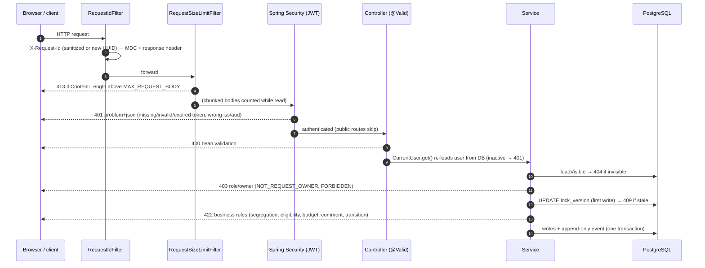

# Security Architecture (as implemented)

## Request pipeline

## Controls by ASVS chapter

| ASVS | Control | Where |
|---|---|---|
| V2 Authentication | bcrypt (cost 10); password policy 8–72 characters, letter + digit, ≤ 72 bytes; same failure message and dummy hash; throttling 5 per account / 50 per client per 15 min | `SecurityConfig.passwordEncoder`, `AdminDtos`, `PasswordRules`, `AuthService.login`, `LoginAttemptLimiter` |
| V3 Session | Stateless HS256 JWT, 15-min TTL, `iss`/`aud`/`exp` required, HS256 pinned; secret ≥ 32 bytes and not a known placeholder; user re-loaded per request | `JwtService`, `SecurityConfig.jwtDecoder/tokenValidator/jwtSigningKey`, `CurrentUser` |
| V4 Access control | Deny by default (`anyRequest().authenticated()`); visibility predicate shared by list, detail and dashboard; 404 before 403 (ADR-012); ADMIN checks in services; `allowedActions` computed server-side | `SecurityConfig`, `AccessPolicy`, `RequestSpecifications.visibleTo`, `RequestAccess` |
| V5 Validation | Record DTOs + Bean Validation; money regex + exact cents; LIKE escaping; sort whitelist; body ≤ 1 MiB; search ≤ 100 characters; page size ≤ 100 | `RequestDtos`, `AdminDtos`, `Money`, `RequestSpecifications`, `RequestSizeLimitFilter` |
| V7 Errors and logging | RFC 9457 problem+json, no stack traces to clients; ECS JSON logs with `requestId`; no credential in logs | `GlobalExceptionHandler`, `ProblemResponses`, `DemoSeed` |
| V8 Data protection | Hash never serialized (`UserMapping`); secrets only from env; `.env` ignored by `.dockerignore`/`.gitignore` | `UserMapping`, `application.yml` |
| V11 Business logic | State machine; segregation; eligibility on the version's cost center; budget conditional UPDATE + CHECK; lock claim; idempotency per user + payload hash | `RequestStateMachine`, `ApprovalPolicies`, `TransitionService`, `BudgetRepository`, `IdempotencyService` |
| V12/V13 API | No CORS (same-origin); CSRF off by design (no cookies); 413/429 with problem+json | `SecurityConfig`, `GlobalExceptionHandler` |
| V14 Configuration | Spring Security default headers (nosniff, `X-Frame-Options: DENY`, no-cache, HSTS on HTTPS); non-root container; JRE-only runtime image; docs can be disabled | `Dockerfile`, `application.yml` |

## Database-level guarantees (defense in depth)

| Guarantee | Mechanism |
|---|---|
| Budget never negative / overdrawn | `CHECK (consumed_cents <= amount_cents)`, `CHECK (≥ 0)` |
| Line totals consistent | `CHECK (line_total_cents = quantity * unit_price_cents)` |
| Audit events append-only | V5 trigger `fn_no_update_delete` on `request_events` |
| Versions immutable | V5 triggers on `request_versions`, `version_items` |
| Decided approval steps immutable, never deleted | V7 trigger `fn_approval_step_guard` |
| One account per e-mail regardless of case | V7 `UNIQUE (lower(email))` |
| Idempotency per user | `PRIMARY KEY (user_id, idem_key)` |

## Front end

- Never trusted for authorization. It renders the server's `allowedActions` and the server re-checks everything.
- Token kept in `sessionStorage` (per tab); a 401 → login with a **sanitized** `returnUrl` (SEC-F02).
- Production builds contain neither the fake backend nor demo credentials (compile-time flags, SEC-F04).
