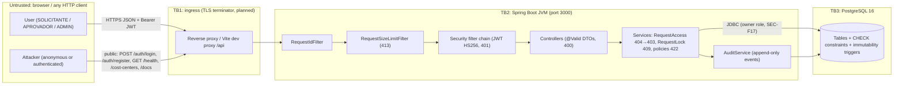

# Threat Model

Method: STRIDE per trust boundary and per business workflow. Assets: [ASSET-INVENTORY.md](ASSET-INVENTORY.md). Controls: [SECURITY-ARCHITECTURE.md](SECURITY-ARCHITECTURE.md). Findings: [FINDINGS.md](FINDINGS.md).

## 1. Attack surface and trust boundaries

**Entry points:**

| # | Entry point | Auth | Notes |
|---|---|---|---|
| E1 | `POST /auth/login` | public | brute force (SEC-F01), body size (SEC-F03) |
| E2 | `POST /auth/register` | public | always `SOLICITANTE`; e-mail enumeration (SEC-F15) |
| E3 | `GET /cost-centers` | public | needed by the sign-up form; codes and names only |
| E4 | `GET /health`, `/docs`, `/v3/api-docs` | public | README §3.1; docs can be switched off (SEC-F25) |
| E5 | `/requests/**` (list, detail, versions, history, create, edit, 5 transitions) | JWT | core business; BOLA, state, concurrency |
| E6 | `/approvals/inbox`, `/dashboard/summary` | JWT | scoped reads |
| E7 | `/users/**`, `POST /cost-centers`, `PUT …/budgets/…` | JWT + ADMIN | vertical escalation target |
| E8 | `GET …/budgets/…` | JWT (any role) | SEC-F14 |
| E9 | SPA (`/login?returnUrl=…`, routes) | browser | open redirect (SEC-F02), build defaults (SEC-F04) |
| E10 | CI (`.github/workflows`), dependency registries | — | supply chain (SEC-F18, SEC-F20) |

**Attackers considered:**
- anonymous internet user;
- authenticated `SOLICITANTE` trying to escalate horizontally or vertically;
- `APROVADOR` trying to approve outside their scope or rules;
- a compromised or malicious `ADMIN` (limited: an ADMIN is trusted by the business rules, but cannot rewrite history);
- a developer workstation targeted through dev tooling;
- an operator misconfiguration (default secrets, demo seed in production).

## 2. STRIDE per boundary

| Boundary | S | T | R | I | D | E |
|---|---|---|---|---|---|---|
| Browser → API (TB1/TB2) | Forged JWT: HS256 pinned, ≥ 32-byte secret, placeholder refused (F13), `iss`/`aud`/`exp` required (F08). Password guessing: throttled (F01) | JSON tampering: server computes totals, DTOs have no privileged fields (FP mass assignment) | `X-Request-Id` on every event | Error bodies are problem+json without internals; 4xx no longer logged as 500 (F10) | Body cap (F03), page size ≤ 100, search ≤ 100 chars (F09), login throttle | Roles re-loaded from the database on every request; ADMIN checks in services |
| API → DB (TB2/TB3) | Single DB credential from env (F23 default) | Parameterized queries only; CHECK constraints; triggers on history and decided steps (F07) | Events are append-only (V5 trigger) | Least privilege missing (F17) | Pool limits (Hikari default) | Owner role could disable triggers (F17) |
| SPA build/host (E9) | Demo credentials removed from production builds (F04) | — | — | Token in `sessionStorage` (F16) | — | Client-side authorization never trusted: the server enforces everything; `allowedActions` only drives buttons |
| CI / supply chain (E10) | — | `npm ci --ignore-scripts`; pinned major tags of first-party actions | — | gitleaks with `--redact` | — | Workflow `permissions: contents: read` by default |

## 3. Workflow threat models

### W1 — Authentication (login / sign-up / session)

| Threat (STRIDE) | Abuse scenario | Control | Residual |
|---|---|---|---|
| S | Online password guessing against an approver | `LoginAttemptLimiter` 5 per account / 50 per client per 15 min → 429 | Lockout of a known e-mail for 15 min (R-07) |
| S | Forge a token with the example secret | Empty example + placeholder refusal (F13) | — |
| S | Replay a token after deactivation | `CurrentUser` re-loads and requires `active` | Valid for other users until `exp` (15 min, F27) |
| I | Enumerate accounts via login timing/messages | Same message + dummy bcrypt | Sign-up 409 reveals e-mails (F15) |
| E | Sign up as ADMIN (`role` in body) | `RegisterInput` has no role; service hard-codes `SOLICITANTE` | — |
| D | Huge login body | 413 filter | — |

### W2 — Create / edit a purchase request

| Threat | Abuse scenario | Control |
|---|---|---|
| T | Send `total`, `status`, `ownerId` | Not in the DTO; the total is computed in exact cents |
| T | Precision tricks (`0.005`, 1e30, negatives) | Regex `\d{1,13}(\.\d{1,2})?`, price > 0, `Math.*Exact` overflow → 400, `CHECK` constraints |
| E | Edit someone else's request (IDOR) | `loadVisible` (404) → `requireOwner` (403) |
| T | Edit after submission or approval | `isEditable()` only in `DRAFT`/`CHANGES_REQUESTED` → 422 |
| T | Lost update | `lockVersion` claim → 409 |
| R/T | Idempotency key replayed with another payload or by another user | Key per user + SHA-256 payload hash → 409 `IDEMPOTENCY_PAYLOAD_MISMATCH` |

### W3 — Submit → approval chain → final approval

| Threat | Abuse scenario | Control |
|---|---|---|
| E | Requester approves own request | `SELF_APPROVAL_FORBIDDEN` (422) |
| E | Same approver signs two steps | `DUPLICATE_APPROVER` (422) per version |
| E | Approver of another cost center approves | Invisible → 404; eligibility uses the **version's** cost center |
| E | N1 approves an N2 step / skip a level | Only the current `PENDING` step is decidable; eligibility per level |
| T | Manipulate the chain (fewer steps) | Chain built server-side from the frozen total and category at submit |
| T | Double approval in a race | Lock claim first write + status-guarded step update → one 200, one 409 |
| T | Overspend the budget with parallel final approvals | Conditional `UPDATE … WHERE consumed + x ≤ amount` + `CHECK` → 422 |
| T | Change the budget below consumed during an approval | `PESSIMISTIC_WRITE` on PUT + `BUDGET_BELOW_CONSUMED` |
| R | Deny a decision | Event with actor, role, request id; decided step immutable (F07) |

### W4 — Return / resubmit / versions

| Threat | Abuse scenario | Control |
|---|---|---|
| T | Rewrite v1 after resubmitting v2 | `request_versions` / `version_items` immutable (V5 trigger) |
| E | Reuse v1 approvals for v2 | Chain rebuilt from zero per version; segregation per version |

### W5 — Administration (users, cost centers, budgets)

| Threat | Abuse scenario | Control | Residual |
|---|---|---|---|
| E | Non-ADMIN calls `/users`, `PUT budgets` | `requireAdmin` → 403 | — |
| T | Concurrent admin edits | `lockVersion` on users | — |
| I | Read other centers' budgets | — | Any authenticated user can (F14, README contract) |
| E | Malicious ADMIN rewrites history | Triggers on events, versions, decided steps | An owner-role connection could drop triggers (F17) |

## 4. Security assumptions

1. TLS is terminated at the ingress; the JVM is not exposed directly to the internet (F22).
2. `JWT_SECRET` is random, at least 32 bytes, and kept only in the environment or a secret store.
3. Production runs with `SEED_ENABLED=false`, or the demo password is rotated (F11).
4. Only a trusted proxy may set forwarded headers (F21).
5. `ADMIN` users are trusted for business decisions (README); the audit trail must still survive them.
6. The SPA host adds security headers (F16, not implemented yet).
